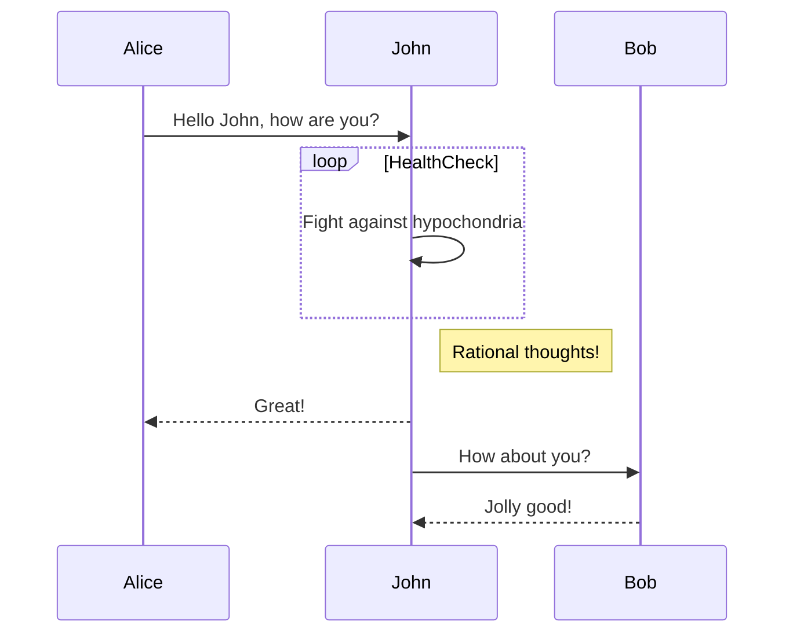

# AI Agent 响应示例

这是一个 **AI Agent** 的响应消息，包含了多种 Markdown 格式：

## 功能特性

- 支持 **粗体** 和 *斜体* 文本
- 支持 [链接](https://github.com/remarkjs/react-markdown)
- 支持代码块和内联代码

### 代码示例

这是一个内联代码示例：`console.log('Hello World')`

```javascript
function greet(name) {
    return `Hello, ${name}!`;
}

const message = greet('用户');
console.log(message);
```



## 视频

<video controls width="100%">
  <source src="http://10.66.95.35:3000/demo.mp4" type="video/mp4">
  您的浏览器不支持视频播放。
</video>

## 音频

<audio controls>
  <source src="http://10.66.95.35:3000/demo.mp3" type="audio/mpeg">
  您的浏览器不支持音频播放。
</audio>

<!-- <audio controls>
  <source src="http://downsc.chinaz.net/Files/DownLoad/sound1/201906/11582.mp3" type="audio/mpeg">
  您的浏览器不支持音频播放。
</audio> -->

## 图片


## katex

Lift($$L$$) can be determined by Lift Coefficient ($$C_L$$) like the following
equation.

$$
L = \frac{1}{2} \rho v^2 S C_L
$$

## svg

```svg
<svg xmlns="http://www.w3.org/2000/svg" version="1.1" xmlns:xlink="http://www.w3.org/1999/xlink" width="300" height="300">
  <rect width="100" height="100" fill="#f06"></rect>
</svg>
```

## markdown Button

<button data-variant="primary" data-size="medium" data-message="Hello World">Click me</button>

<button data-variant="warning" data-size="medium" data-message="Hello World">Click me</button>
