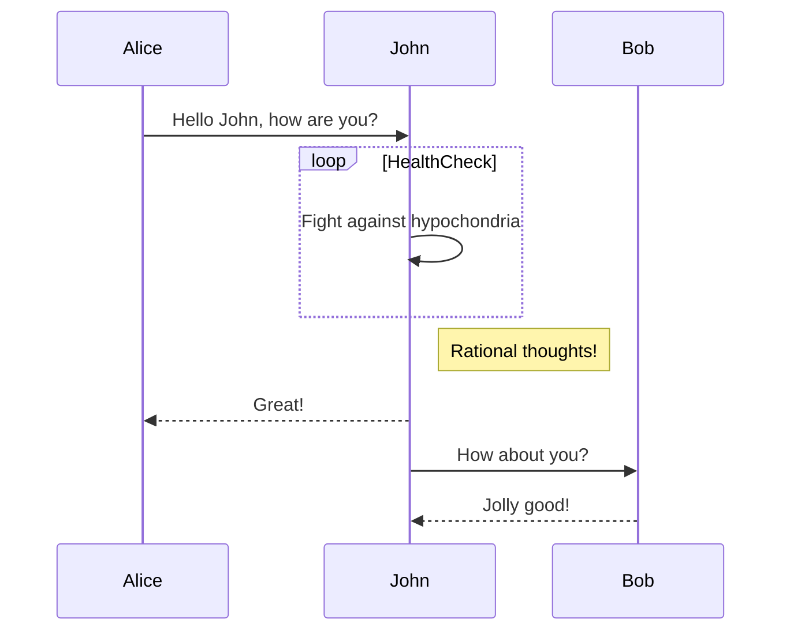

# AI Agent 响应示例

这是一个 **AI Agent** 的响应消息，包含了多种 Markdown 格式：

## 功能特性

- 支持 **粗体** 和 *斜体* 文本
- 支持 [链接](https://github.com/remarkjs/react-markdown)
- 支持代码块和内联代码

### 代码示例

这是一个内联代码示例：`console.log('Hello World')`

```javascript
function greet(name) {
    return `Hello, ${name}!`;
}

const message = greet('用户');
console.log(message);
```


